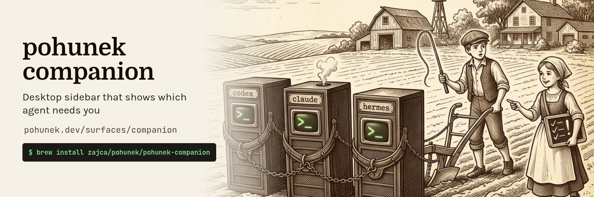
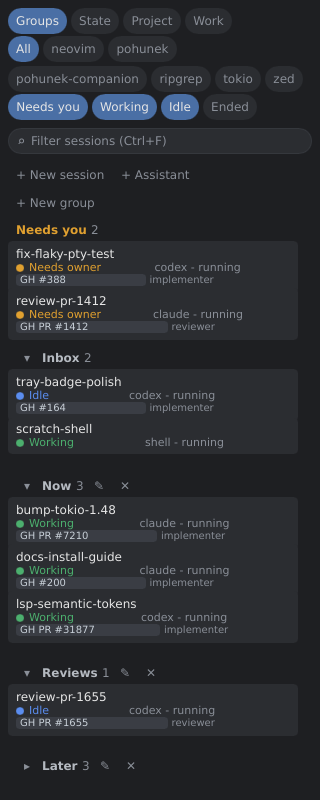
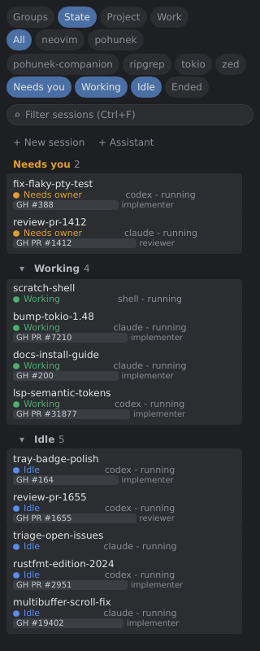
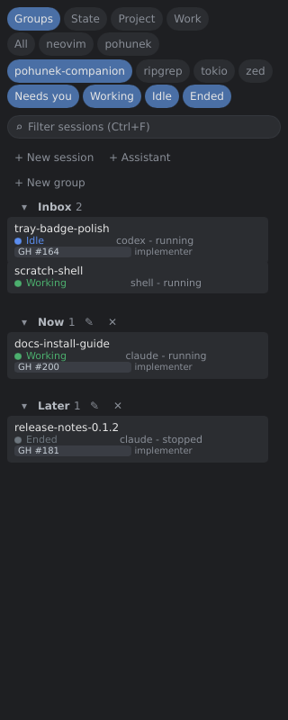
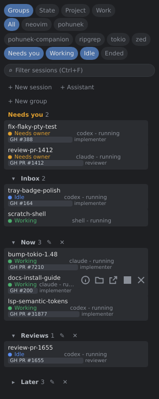
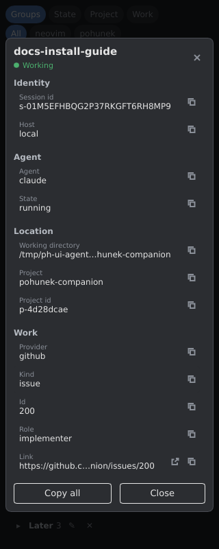
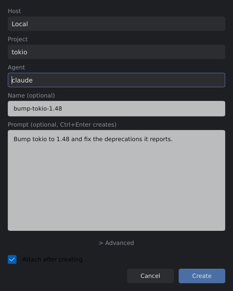
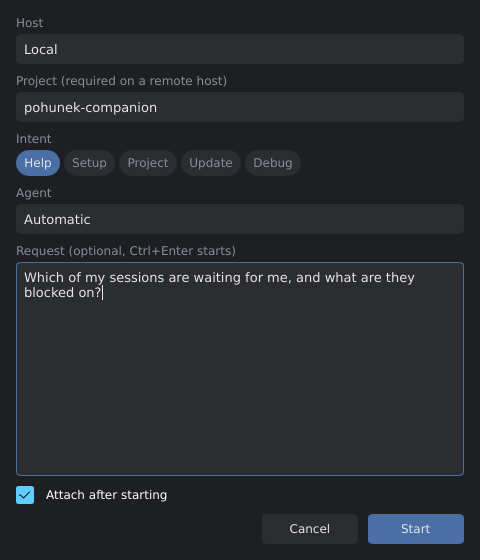
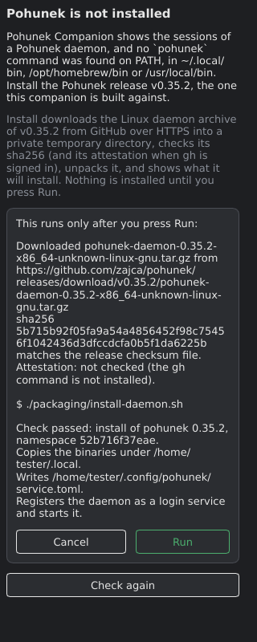

<p align="center">
  
</p>

<p align="center">
  <a href="https://pohunek.dev/surfaces/companion/">pohunek.dev/surfaces/companion</a>
  ·
  <a href="https://pohunek.dev/docs/">Pohunek docs</a>
  ·
  <a href="https://github.com/pohunekd/pohunek-companion/releases/latest">Latest release</a>
</p>

<p align="center">
A narrow desktop sidebar for everyone who runs many coding-agent sessions:
see which ones need you, which are working and which sit idle, without
switching terminals.
</p>

<p align="center">
  
</p>

Pohunek Companion is a small native app (Rust and [Slint](https://slint.dev),
Linux Wayland and macOS) for the owner of a [Pohunek](https://github.com/zajca/pohunek)
daemon. It is a client of the Pohunek protocol and owns no session state: the
daemon runs the sessions, the companion shows them and starts new ones.

See [docs/architecture.md](docs/architecture.md), the
[project board](https://github.com/orgs/pohunekd/projects/1) and the
[companion page on pohunek.dev](https://pohunek.dev/surfaces/companion/).

## Why

Five agents in five terminals means a lot of tab switching to learn that one
of them has been waiting for an answer for twenty minutes. The companion keeps
one list in view, lifts the sessions that are blocked on you to the top, and
lets you jump straight into any of them.

## Features

### Live state and attention

Every row shows the agent, its state (working, idle, needs owner, ended), the
Pohunek Work link (for example a GitHub PR or issue) and the role. Sessions
that need you are lifted into a "Needs you" section at the top; an idle session
counts as idle only after a configurable threshold, so a short pause is not
reported as waiting. Clicking a row attaches a terminal to the session.

### Tray icon

The tray icon is the Pohunek herder figure with a badge in the colour of the
most urgent state, showing the number of sessions that need you. Its menu lists
those sessions and attaches on click, and has entries for New session and
Assistant. A Linux tray needs a StatusNotifierItem host (a bar with a tray
module, or the AppIndicator extension on GNOME).

### Groups and drag-and-drop layout

Arrange sessions into your own groups by dragging rows and group headers.
Groups can be renamed, collapsed and deleted, and the layout is stored per
user, never in the daemon. The same sessions can also be sectioned by state, by
project or by Work item.

<p align="center">
  
</p>

### Filters

Chips narrow the list by project and by state, and a text filter (Ctrl+F, or
Cmd+F on macOS) searches names. Ended sessions are hidden until you turn their
chip on.

<p align="center">
  
</p>

### Session actions and details

Hovering a row shows its actions: details, open the working directory, open
the Work link, stop and remove. The details view lists the session id, host,
agent, state, working directory, project and Work metadata, each with a copy
button.

<p align="center">
  
  
</p>

### Resume

An ended session that the daemon can resume gets a Resume action on its row and
in its details view. When the daemon cannot resume it, the details view says
why in one sentence.

### New session and Assistant

"+ New session" opens a dialog to start a session on a host, in a project, with
an agent, an optional name and an optional prompt. "+ Assistant" starts a
Pohunek assistant session with a request and an intent. Both dialogs are
separate processes, so they can also be bound to a desktop keybinding.

<p align="center">
  
  
</p>

### Multiple hosts

Besides the local daemon the companion can follow daemons on other machines
over the NetBird overlay. Rows carry their host, a host that drops off keeps
its last-known rows dimmed and marked unreachable, and a Hosts control filters
the list by host.

### Desktop launcher entry (Linux)

`pohunek-companion desktop install` writes a desktop entry and icons for the
current user, so wofi, rofi, GNOME and KDE list the app. The entry has a
`New session` and an `Assistant` action.

## Install

The companion needs a running [Pohunek](https://github.com/zajca/pohunek)
daemon on the same machine. Without one, the window shows a setup screen
instead of the list: it says whether the `pohunek` command is missing (with the
install commands), the login service is not installed, or the daemon is not
running, and offers to install Pohunek or its service, or to start the service,
after showing the exact command and what it touches. On Linux x86_64 the
Install button downloads the Pohunek release this companion is built against
(never "latest") from GitHub over HTTPS, checks its sha256 (and its attestation
when `gh` is signed in), unpacks it, shows what `packaging/install-daemon.sh`
will write, and runs it only after you press Run; a checksum mismatch refuses
the install. On macOS with Homebrew it runs `brew install zajca/pohunek/pohunek`
(not verified on a Mac yet). It never runs `pohunek assistant setup` or
`pohunek integration install`: they are named as next steps. The download
location is `setup.release_base_url` in `companion.toml`. Nothing is installed
without your click and a second confirmation, and the screen gives way to the list as soon as the daemon
answers. A daemon whose protocol does not match the companion's is named there
with both versions.

<p align="center">
  
</p>

### macOS (Apple Silicon, macOS 14 or later)

```bash
brew install zajca/pohunek/pohunek-companion
```

The formula installs the ad-hoc signed `Pohunek Companion.app` and puts
`pohunek-companion` on the `PATH`.

<details>
<summary>Manual download and verification</summary>

Each `vX.Y.Z` release has `pohunek-companion-<version>-aarch64-apple-darwin.tar.gz`
and a `.sha256` file beside it. The archive holds `Pohunek Companion.app`,
`LICENSE` and `README.md`.

The app is ad-hoc signed and not notarized. A file downloaded in a browser gets
the `com.apple.quarantine` attribute, and Gatekeeper then refuses to open it.
Download with `curl` (or `gh`), which does not set the attribute:

```bash
v=0.1.3
a=pohunek-companion-$v-aarch64-apple-darwin.tar.gz
curl -fLO https://github.com/pohunekd/pohunek-companion/releases/download/v$v/$a
curl -fLO https://github.com/pohunekd/pohunek-companion/releases/download/v$v/$a.sha256
shasum -a 256 -c $a.sha256
gh attestation verify $a --repo pohunekd/pohunek-companion
tar -xzf $a
codesign --verify --deep --strict pohunek-companion-$v-aarch64-apple-darwin/"Pohunek Companion.app"
```

</details>

### Linux (x86_64)

Each `vX.Y.Z` release has `pohunek-companion-<version>-x86_64-unknown-linux-gnu.tar.gz`
and a `.sha256` file beside it. The binary is dynamically linked against glibc.

```bash
v=0.1.3
a=pohunek-companion-$v-x86_64-unknown-linux-gnu.tar.gz
gh release download v$v -R pohunekd/pohunek-companion -p "$a*"
sha256sum -c $a.sha256
gh attestation verify $a --repo pohunekd/pohunek-companion
tar -xzf $a && ./pohunek-companion-$v-x86_64-unknown-linux-gnu/pohunek-companion --version
```

Linked at start (`ldd`): fontconfig, freetype (with expat, zlib, bzip2, libpng,
brotli), libgcc_s, libm and libc. Wayland, X11 and GL libraries are loaded at
run time by the window system layer, so a working Wayland or X11 desktop with
its usual Mesa/EGL stack is also required.

#### Application launchers (desktop entry and icons)

Launchers such as wofi, rofi (`drun`), GNOME and KDE list an app only when an
XDG desktop entry exists. Two routes install it, both for the current user:

```bash
# 1. From the binary: writes the entry and the hicolor icons.
pohunek-companion desktop install
pohunek-companion desktop uninstall   # removes exactly those files

# 2. By hand, from the release archive.
cd pohunek-companion-<version>-x86_64-unknown-linux-gnu
install -Dm755 pohunek-companion ~/.local/bin/pohunek-companion
cp -r share/. "${XDG_DATA_HOME:-$HOME/.local/share}/"
```

<details>
<summary>Details of the desktop entry</summary>

`desktop install` writes `$XDG_DATA_HOME/applications/pohunek-companion.desktop`
(`~/.local/share` when `XDG_DATA_HOME` is unset) and the icons under
`$XDG_DATA_HOME/icons/hicolor/`. Its `Exec` is the absolute path of the binary
that ran it, so run it from the final location; run it again after moving the
binary. It refreshes the desktop database with `update-desktop-database` when
it is installed, and the icon cache with `gtk-update-icon-cache` only where the
hicolor directory has an `index.theme`. The manual route needs
`~/.local/bin` on `PATH`, because the archive's entry runs `pohunek-companion`
by name. The subcommand is Linux-only; macOS uses the app bundle.

</details>

## Command line

```bash
pohunek-companion                                  # the sidebar
pohunek-companion new-session [--host TARGET] [--project ID] [--group ID]
pohunek-companion assistant   [--host TARGET] [--project ID] [--intent INTENT]
pohunek-companion desktop install | uninstall      # Linux only
pohunek-companion completions bash | zsh | fish    # completion script on stdout
```

`new-session` and `assistant` open their dialog directly, which makes them
convenient targets for a compositor or desktop keybinding. `--help` lists every
flag. Behaviour such as
the attach command, the idle threshold and placement rules is set in
`companion.toml`; see [docs/architecture.md](docs/architecture.md).

### Shell completion

`completions <shell>` prints a script that completes subcommands, flags and the
`--intent` values. The Linux release archive already carries the scripts under
`share/`, so the `cp -r share/.` step above installs them (zsh also needs
`~/.local/share/zsh/site-functions` on `fpath`, as below). Otherwise:

```bash
# bash: loaded on demand by bash-completion
mkdir -p ~/.local/share/bash-completion/completions
pohunek-companion completions bash > ~/.local/share/bash-completion/completions/pohunek-companion

# zsh: put the directory on fpath before compinit in ~/.zshrc
mkdir -p ~/.local/share/zsh/site-functions
pohunek-companion completions zsh > ~/.local/share/zsh/site-functions/_pohunek-companion
# fpath=(~/.local/share/zsh/site-functions $fpath)

# fish
pohunek-companion completions fish > ~/.config/fish/completions/pohunek-companion.fish
```

`completions <shell> --dynamic` prints a one-line bootstrap instead (for
example `source <(pohunek-companion completions bash --dynamic)` in
`~/.bashrc`) that also completes `--host`, `--project` and `--group` from the
local daemon, `companion.toml` and the layout file (`--project` always asks
the local daemon). Every lookup stops after
750 ms and prints nothing on failure, so Tab without a daemon offers only the
values that need none.

## Development

```bash
cargo run -p pohunek-companion
scripts/gates                  # fmt, clippy, tests: the set CI runs
scripts/ui-agent start --showcase   # headless app on an isolated daemon with synthetic showcase data
```

The screenshots above come from `scripts/ui-agent start --showcase`: a
headless run against an isolated Pohunek daemon filled with synthetic projects
and sessions, so nothing in them comes from a real daemon. Contributors and
agents start at [AGENTS.md](AGENTS.md).

## License

Licensed under MIT. Built with Slint under the Slint Royalty-free License.
